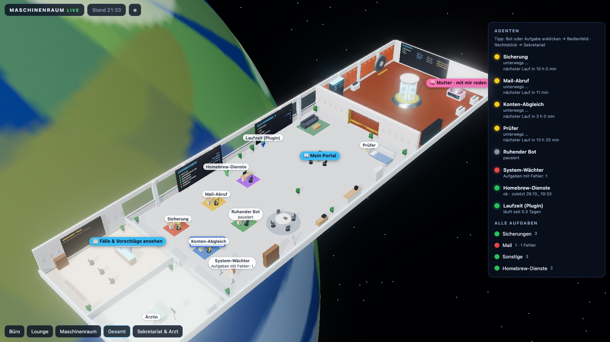
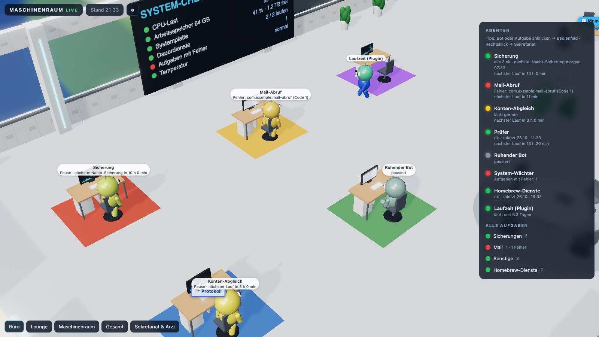
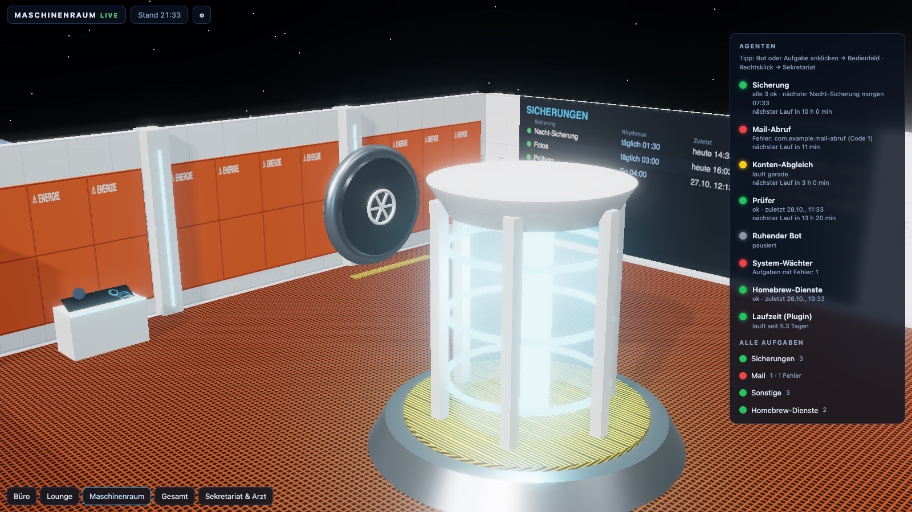
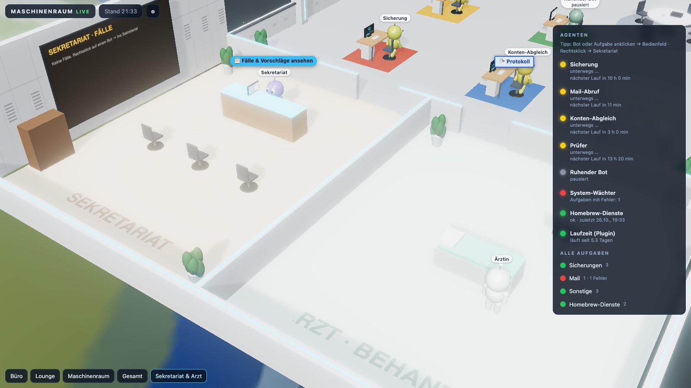

**Deutsch** · [English](README.en.md)

# Maschinenraum

**Ein 3D-Leitstand für die Hintergrund-Dienste eines Macs.** Jeder Dienst (launchd-LaunchAgent) wird zu einer kleinen Figur in einem begehbaren Raumschiff-Büro. Die Körperfarbe zeigt den Zustand: grün = ok, gelb = läuft, rot = Fehler, grau = aus. Ein Klick auf eine Figur öffnet das Bedienfeld zum Starten, Stoppen, Pausieren, Deaktivieren und Protokoll-Lesen.



## Was es kann

- **Live-Zustand** aller eigenen LaunchAgents: Status, Exit-Code, Zeitplan, letzter und nächster Lauf. Aktualisiert jede Minute.
- **Bots** frei konfigurierbar: welche Aufgaben ein Bot beobachtet, wo er sitzt, was er tut, welche Farbe er hat.
- **Räume als Bausteine** (`raeume/*.json`): Büro, Lounge, Maschinenraum, Sekretariat und Arzt. Räume lassen sich anlegen, verschieben, austauschen und weglassen.
- **Austauschbares Aussehen** (`web/bibliothek/*.js`): Möbel, Wände, Böden und Figuren kommen aus einer Bibliothek. Eine andere Bibliothek gibt dem Ganzen ein anderes Aussehen.
- **Bedienfeld** pro Bot oder Aufgabe mit Klartext-Diagnose (z. B. „Dem Programm fehlt der Festplattenvollzugriff“) und dem Knopf „Freigabe geben“.
- **Wandtafeln** mit System-Check, allen Aufgaben, den Sicherungen und den Fällen.
- **Plugins** (`plugins/*.py`): eigene Datenquellen für Bots, z. B. eine Datenbank oder eine Web-API.
- **Mit Claude Code** (optional, [Claude Code CLI](https://docs.anthropic.com/claude-code) nötig):
  - **Mutter**, der Großrechner: Gespräch über den Zustand, nur lesend. Aufträge lassen sich speichern.
  - **Sekretariat**: Rechtsklick auf einen Bot. Claude untersucht Skripte und Protokolle, nur lesend, und macht 3 Vorschläge.
  - **Arzt**: Mit einem Vorschlag repariert Claude den Bot. Vorher legt er Sicherungen an, löscht nichts, kein sudo. Danach startet die Aufgabe neu.

## Bilder

| Büro | Maschinenraum | Sekretariat & Arzt |
|---|---|---|
|  |  |  |

## Schnellstart

Voraussetzung: macOS mit dem mitgelieferten `/usr/bin/python3`. Zusatzpakete sind nicht nötig. Die Seite lädt three.js aus dem jsDelivr-CDN.

```bash
git clone <dieses-repository> maschinenraum && cd maschinenraum
./start.sh
```

Dann im Browser `http://127.0.0.1:8790` öffnen und aufs Zahnrad klicken.

**Nur anschauen, ohne echte Dienste:** `MR_DEMO=1 ./start.sh` zeigt erfundene Beispieldaten. Im Demo-Modus wird nichts ausgeführt.

Ohne eigene Konfiguration gilt `config.example.json`. Sie zeigt alle LaunchAgents, die nicht von Apple stammen, und einige Beispiel-Bots.

## Eigene Konfiguration

```bash
mkdir -p privat && cp config.example.json privat/config.json
```

Dann `privat/config.json` anpassen. Der Ordner `privat/` kommt **nie** ins Repository (siehe `.gitignore`), und dort gehört alles Persönliche hin:

| Was | Wo |
|---|---|
| Bots, Aufgaben, Sicherungen, Regeln, Links | `privat/config.json` |
| eigene Datenquellen | `privat/plugins/*.py` |
| eigene Räume (überschreiben gleichnamige) | `privat/raeume/*.json` |
| eigene Bibliotheken (Aussehen) | `privat/bibliothek/*.js` |
| Laufzeitdaten (Status, Fälle, Aufträge) | `daten/` (wird automatisch angelegt) |

Die vollständige Beschreibung aller Felder steht in **[AGENTS.md](AGENTS.md)**. Sie ist so geschrieben, dass man sie auch einer KI geben kann: „Lies AGENTS.md und richte mir einen Bot für meinen Backup-Dienst ein.“

## Als Dienst einrichten

```bash
scripts/dienst-einrichten.sh local.maschinenraum
```

Damit startet der Maschinenraum beim Anmelden und nach einem Absturz neu. Trage dasselbe Label als `"eigenes_label"` in der Konfiguration ein. Dann kann sich der Maschinenraum nicht selbst abschalten.

## Sicherheit

- Der Server lauscht nur auf `127.0.0.1`. Für den Zugriff von anderen Geräten eignet sich z. B. `tailscale serve` (nur im eigenen Netz). **Nicht ins offene Internet stellen**, denn die Seite kann Dienste steuern.
- Steuerbefehle (POST) werden nur mit der Kopfzeile `X-Maschinenraum: 1` angenommen, die die eigene Seite mitschickt.
- Bedient werden nur LaunchAgents, deren Label zu `prefixe` passt. Ohne Liste gilt das für alle außer Apple-Diensten.
- `status.json` enthält keine Programm-Argumente, Umgebungsvariablen oder Log-Inhalte. Protokolle werden beim Anzeigen geschwärzt (`password=…`, `token=…` usw.).
- **Der Arzt verändert Dateien.** Claude bekommt dafür die Rechte `Edit`/`Write` in den Ordnern des betroffenen Dienstes und eine kleine Liste erlaubter Befehle. `rm`, `sudo`, `launchctl bootout/disable`, `security` und Web-Zugriff sind gesperrt. Er läuft nur, wenn du ihn ausdrücklich mit einem Vorschlag losschickst.

## Aufbau

```
server.py              Sammler + HTTP-Server (Python 3.9, keine Abhängigkeiten)
start.sh               Startskript
config.example.json    Beispiel-Konfiguration
web/index.html         Seite
web/app.js             Bots, Live-Status, Bedienfeld, Sekretariat/Arzt, Mutter
web/welt.js            baut die Welt aus Räumen + Bibliothek, Wegfindung
web/bibliothek/        Aussehen (standard.js = Raumschiff-Büro)
raeume/                Raum-Vorlagen (JSON)
plugins/               Beispiel-Plugin
scripts/               Einrichtung als LaunchAgent
AGENTS.md              vollständige Referenz (für Menschen und KI)
```

## Lizenz

MIT, siehe [LICENSE](LICENSE).
